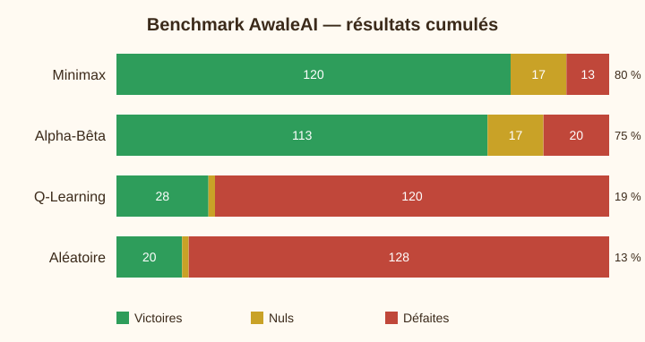

# Benchmark des agents AwaleAI

_Généré le 2026-11-19 19:08 — durée 44 s_

## Protocole

- **50 parties par duel**, tournoi toutes-rondes (6 duels, 300 parties).
- Profondeur de recherche : Minimax = 4, Alpha-Bêta = 4 ; Q-Learning glouton (sans exploration).
- Ouvertures : 2 demi-coups aléatoires, chaque ouverture jouée deux fois en inversant les couleurs (chaque agent commence la moitié des parties).
- Nul si répétition de position ou plus de 400 demi-coups. Graine aléatoire : 2026.

## Classement général

| Rang | Agent | Victoires | Nuls | Défaites | Taux de victoire | Graines moy. (pour–contre) | Temps / coup | Nœuds / coup |
|---|---|---|---|---|---|---|---|---|
| 1 | **Minimax** | 120 | 17 | 13 | 80 % | 28.2 – 8.4 | 35.92 ms | 454 |
| 2 | **Alpha-Bêta** | 113 | 17 | 20 | 75 % | 27.2 – 8.8 | 6.90 ms | 139 |
| 3 | **Q-Learning** | 28 | 2 | 120 | 19 % | 8.6 – 29.2 | 0.41 ms | — |
| 4 | **Aléatoire** | 20 | 2 | 128 | 13 % | 8.7 – 26.2 | 0.04 ms | — |

## Matrice des taux de victoire (ligne contre colonne)

| | Aléatoire | Minimax | Alpha-Bêta | Q-Learning |
|---|---|---|---|---|
| **Aléatoire** | — | 0 % (0/50) | 0 % (0/50) | 40 % (20/50) |
| **Minimax** | 100 % (50/50) | — | 40 % (20/50) | 100 % (50/50) |
| **Alpha-Bêta** | 100 % (50/50) | 26 % (13/50) | — | 100 % (50/50) |
| **Q-Learning** | 56 % (28/50) | 0 % (0/50) | 0 % (0/50) | — |

## Détail des duels

| Duel | Score (V–N–D) | Graines moy. | Coups moy. | Fin de partie (score / blocage / répét. / limite) | Temps / coup |
|---|---|---|---|---|---|
| Aléatoire vs Minimax | 0–0–50 | 3.5 – 28.6 | 47 | 47 / 3 / 0 / 0 | 0.04 ms – 46.27 ms |
| Aléatoire vs Alpha-Bêta | 0–0–50 | 3.1 – 28.8 | 43 | 49 / 1 / 0 / 0 | 0.03 ms – 8.57 ms |
| Aléatoire vs Q-Learning | 20–2–28 | 19.6 – 21.1 | 144 | 37 / 11 / 2 / 0 | 0.04 ms – 0.65 ms |
| Minimax vs Alpha-Bêta | 20–17–13 | 21.3 – 19.3 | 171 | 30 / 3 / 17 / 0 | 30.56 ms – 6.31 ms |
| Minimax vs Q-Learning | 50–0–0 | 34.6 – 2.5 | 50 | 40 / 10 / 0 / 0 | 44.80 ms – 0.07 ms |
| Alpha-Bêta vs Q-Learning | 50–0–0 | 33.6 – 2.1 | 51 | 44 / 6 / 0 / 0 | 7.51 ms – 0.05 ms |

## Minimax vs Alpha-Bêta à profondeur égale (4)

Sur **200 positions** variées, chaque algorithme choisit un coup :

| Mesure | Minimax | Alpha-Bêta |
|---|---|---|
| Nœuds explorés (moyenne) | 675 | 218 |
| Temps par coup (moyenne) | 51.70 ms | 10.95 ms |

- Coup d'Alpha-Bêta **optimal au sens de Minimax** (même valeur que le meilleur coup Minimax) : **100 %** des positions.
- Coup strictement identique : **94 %** des positions (**100 %** hors égalités ; 12 % des positions ont plusieurs coups de même valeur, que Minimax départage au hasard).
- Alpha-Bêta explore **68 % de nœuds en moins** et est **4.7× plus rapide**.

> Les deux agents utilisent la même fonction d'évaluation (`agents/heuristic/heuristic.py`) : Alpha-Bêta n'est qu'une optimisation de Minimax.

